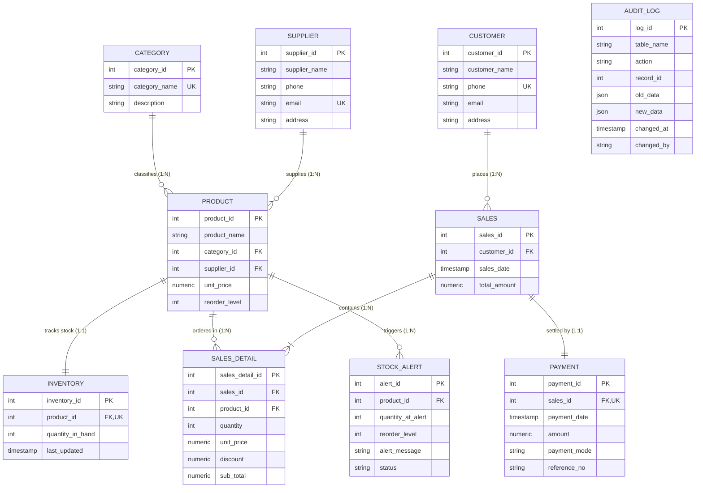

# StockPulse — Retail Inventory & Sales Command Center


> **StockPulse** is a production-grade Retail Inventory, Sales Management, and Point-of-Sale (POS) System built for high-throughput retail operations. Designed in strict compliance with **Third Normal Form (3NF)** with pessimistic locking and ACID transaction guarantees, it couples an enterprise relational database engine with a modern Next.js 14 full-stack web application.

---

## 📑 Table of Contents
1. [🌟 System Highlights & Key Features](#-system-highlights--key-features)
2. [👥 Role-Based Access Control (RBAC) & Demo Logins](#-role-based-access-control-rbac--demo-logins)
3. [🚀 Quickstart Guide (Web App & Database)](#-quickstart-guide-web-app--database)
   - [Running with MySQL (Server & Workbench)](#option-a-mysql-server--workbench-recommended)
   - [Running with Docker & PostgreSQL 16](#option-b-running-via-docker--postgresql-16)
   - [Running with Local PostgreSQL](#option-c-running-with-local-postgresql)
4. [📐 Entity-Relationship (ER) Design](#-entity-relationship-er-design)
5. [🔬 Database Normalization Proof (1NF to 3NF)](#-database-normalization-proof-1nf-to-3nf)
6. [⚡ Business Logic, Automation & Triggers](#-business-logic-automation--triggers)
7. [⚙️ ACID Properties In-Depth Demonstration](#-acid-properties-in-depth-demonstration)
8. [📊 Analytical Views & 15 Advanced Demonstration Queries](#-analytical-views--15-advanced-demonstration-queries)
9. [🧪 Automated Test Suite](#-automated-test-suite)
10. [📂 Project Structure](#-project-structure)

---

## 🌟 System Highlights & Key Features

### 🖥️ Full-Stack Web Application (Next.js 14 + React 18)
- **Interactive POS Billing Terminal**: Lightning-fast barcode/search checkout, quantity adjustment, discount allocation, payment modes (Cash, Card, UPI, NetBanking), and instant printable/downloadable PDF receipts (`jspdf` + `jspdf-autotable`).
- **Live Inventory Command Center**: Real-time stock level monitoring with dynamic threshold alerts, low-stock warnings, and warehouse status badges.
- **Product Catalog Management**: Multi-category taxonomy (Grocery, Personal Care, Dairy, Beverages, Snacks), SKU tracking, pricing, and reorder levels.
- **Sales History & Itemized Invoicing**: Transaction ledger with invoice modal inspect, line-item discounts, and payment verification.
- **Business Intelligence (BI) Analytics**: Interactive charts using Recharts for daily/monthly revenue trends, category revenue breakdown, and top-selling SKUs.
- **Interactive ACID Viva Demo (`/acid` / `/acid-demo`)**: Real-time visual demonstrator of Atomicity (multi-item rollback), Consistency (invariant checks), Isolation (row-level locking), and Durability.
- **Universal Database Engine Support**: Seamlessly works with **MySQL Server / MySQL Workbench** or **PostgreSQL 16**.

---

## 👥 Role-Based Access Control (RBAC) & Demo Logins

The application features full JWT-based authentication with role-specific access permissions. Quick-fill credentials are provided directly on the login screen (`/login`):

| Role | Username | Password | Permissions |
| :--- | :--- | :--- | :--- |
| **Admin** | `user_admin` | `Admin@Secure123` | Full system access, catalog modifications, stock adjustment, audit logs, reports, and administrative settings. |
| **Manager** | `user_manager` | `Manager@Secure123` | Inventory replenishment, vendor management, product updates, and analytics views. Cannot drop tables or modify RBAC. |
| **Cashier** | `user_cashier` | `Cashier@Secure123` | POS billing checkout, viewing products and stock availability, customer receipt creation. Restricted from direct stock alterations. |

---

## 🚀 Quickstart Guide (Web App & Database)

### Prerequisites
- **Node.js** v18+ and **npm**
- **MySQL 8.0+** (via MySQL Workbench / Server) **OR** **PostgreSQL 16+** / **Docker**

### 1. Clone & Install Dependencies
```bash
git clone https://github.com/nandpatel7069/Stock-Pulse.git
cd Stock-Pulse
npm install
```

### 2. Configure Environment Variables
Copy the template configuration file:
```bash
cp .env.example .env
```
Open `.env` and verify your database credentials (e.g. `DB_PASSWORD=your_mysql_password`).

---

### Option A: MySQL Server & Workbench (Recommended)

1. **Initialize the MySQL database and sample data:**
   ```bash
   # Method 1: Using the automated Python initialization script
   python3 init_mysql_database.py

   # OR Method 2: Import the SQL script in MySQL Workbench or CLI
   mysql -u root -p < database/retail_db_mysql.sql
   ```
2. **Start the Next.js development server:**
   ```bash
   npm run dev
   ```
3. **Open the application:**
   Navigate to [http://localhost:3000](http://localhost:3000) in your browser.

---

### Option B: Running via Docker & PostgreSQL 16

1. **Start the PostgreSQL 16 container:**
   ```bash
   docker compose up -d
   ```
2. **Execute seed and initialization scripts inside the container:**
   ```bash
   docker exec -it retail_db_container psql -U postgres -d retail_db -f /database/run_all.sql
   ```
3. **Start the web application:**
   ```bash
   npm run dev
   ```

---

### Option C: Running with Local PostgreSQL

```bash
# 1. Create the database
psql -U postgres -c "CREATE DATABASE retail_db;"

# 2. Initialize schema, triggers, views, roles, and seed data
psql -U postgres -d retail_db -f database/run_all.sql

# 3. Start the Next.js dev server
npm run dev
```

---

## 📐 Entity-Relationship (ER) Design

### Entity-Relationship Diagram



---

## 🔬 Database Normalization Proof (1NF to 3NF)

### First Normal Form (1NF)
A relation is in 1NF if and only if all domain values are atomic (indivisible) and each tuple contains no repeating groups.
- **Atomic Attributes**: Repeating item arrays are extracted into `sales_detail`, where each record represents a single discrete item.
- **Entity Uniqueness**: Every table maintains a strict Primary Key (`INT AUTO_INCREMENT` / `IDENTITY`).
- **Standardized Types**: Precision data types (`DECIMAL(10,2)`, `DATETIME`, `VARCHAR`) prevent loose unstructured strings.

### Second Normal Form (2NF)
A relation is in 2NF if it is in 1NF and **every non-prime attribute is fully functionally dependent on the entire primary key** (no partial dependency on candidate keys).
- In a composite table `{sales_id, product_id}`, storing `customer_name` would create a partial dependency (`sales_id -> customer_name`).
- **Resolution**:
  - `sales` header stores attributes dependent strictly on `sales_id` (`customer_id`, `sales_date`, `total_amount`).
  - `sales_detail` stores transaction line specifics (`quantity`, `unit_price`, `discount`, `sub_total`).
  - `product` catalog isolates product metadata (`product_name`, `unit_price`, `reorder_level`).

### Third Normal Form (3NF)
A relation is in 3NF if it is in 2NF and **no non-prime attribute is transitively dependent on the primary key** ($X \rightarrow Y$ and $Y \rightarrow Z$, where $Y$ is not a superkey).
- **Transitive Dependency 1 (Supplier details in Product)**:
  - $\text{product\_id} \rightarrow \text{supplier\_id}$ and $\text{supplier\_id} \rightarrow \text{supplier\_phone}$.
  - **Resolution**: Normalized into a dedicated `supplier` relation.
- **Transitive Dependency 2 (Category taxonomy)**:
  - $\text{product\_id} \rightarrow \text{category\_id}$ and $\text{category\_id} \rightarrow \text{category\_description}$.
  - **Resolution**: Normalized into a dedicated `category` table.
- **Transitive Dependency 3 (Payment settlement)**:
  - Payments are isolated into `payment` with a 1:1 foreign key referencing `sales(sales_id)`.

---

## ⚡ Business Logic, Automation & Triggers

1. **`trg_calc_sales_detail_subtotal`**: Automatically computes `sub_total = (quantity * unit_price) - discount`. Validates that discounts cannot exceed gross item cost.
2. **`trg_sync_inventory_on_sales_detail`**: Pessimistic locking prevents race conditions and strictly aborts any transaction attempting to sell more units than are in stock.
3. **`trg_sync_sales_total`**: Automatically synchronizes and recalculates invoice totals upon insertion, updating, or returning of line items.
4. **`trg_inventory_stock_alert`**: Monitors stock levels after each sale. If `quantity_in_hand <= reorder_level`, an automated alert is triggered into `stock_alert`.
5. **`trg_audit_product` & `trg_audit_inventory`**: Records immutable JSON snapshots into `audit_log` with user stamps and change delta.

---

## ⚙️ ACID Properties In-Depth Demonstration

| ACID Pillar | Implementation in StockPulse | Verification Demonstration |
| :--- | :--- | :--- |
| **Atomicity** *(All or Nothing)* | Stored procedure checkout / transactional batches encapsulate checkout. If any single item fails stock validation, the entire transaction is rolled back. | Multi-item checkout where Item 2 exceeds available inventory rolls back Item 1; 0 headers created. |
| **Consistency** *(Invariants)* | Integrity constraints enforce invariants: `CHECK (unit_price > 0)`, `CHECK (quantity_in_hand >= 0)`, foreign key `RESTRICT` rules. | Stock can never drop below zero; triggers trap oversell attempts. |
| **Isolation** *(Concurrent Safety)* | Pessimistic locking (`FOR UPDATE`) on inventory rows during checkout prevents dirty reads, non-repeatable reads, and phantom sales. | Concurrent orders targeting the same SKU execute serially without race condition leaks. |
| **Durability** *(Committed Persistence)* | Relational database write-ahead logging (WAL/InnoDB redo log) guarantees all committed checkouts survive system restarts. | Committed receipts persist permanently in `sales`, `sales_detail`, and `payment`. |

---

## 📊 Analytical Views & 15 Advanced Demonstration Queries

### Analytical Views
- `v_low_stock`: Real-time replenishment list ranking SKUs by shortage severity and restock cost.
- `v_inventory_valuation`: Category-wise stock unit counts, total asset valuation in INR, and price bounds.
- `v_daily_sales`: Daily order volume, gross sales, discounts given, net revenue, and average basket size.
- `v_monthly_sales`: Month-over-month revenue trends.
- `v_product_wise_sales`: Granular product sales performance, units sold, and inventory turnover ratio.
- `v_top_customers`: CRM segmentation categorizing shoppers into Platinum, Gold, Silver, and Bronze tiers.
- `v_supplier_product_map`: Vendor risk analysis showing supplied SKU counts and active alerts.
- `v_category_revenue`: Department sales distribution and percentage contribution to total store turnover.

### 15 Advanced Demonstration Queries (in `database/queries.sql`)
1. Multi-Table `INNER JOIN` Invoice Reconciliation
2. `GROUP BY` & Multi-Metric Aggregation
3. `HAVING` High-Turnover Department Filtering
4. Correlated Subquery for Above-Average Category Pricing
5. Scalar Subquery Variance vs Historical Average Order Value (AOV)
6. `IN` / `NOT IN` Resilient Supplier Identification
7. `EXISTS` & `NOT EXISTS` Cross-Sell Affinity Analysis
8. Common Table Expression (CTE) & `LAG()` Month-over-Month Growth
9. Recursive CTE Date-Series Generation (Zero-Sale Day Detection)
10. Window Function `DENSE_RANK()` Category Revenue Leaders
11. Window Function Cumulative Running Total (`SUM() OVER`)
12. Window Function `LAG()` Inter-Purchase Repurchase Cycles
13. Window Function `NTILE(4)` Customer RFM Quartile Segmentation
14. Conditional Aggregation Matrix (Payment Mode Pivot)
15. Inventory Velocity Categorization (*Fast Mover*, *Regular*, *Slow Mover*, *Dead Stock*)

---

## 🧪 Automated Test Suite

Run the automated test suite to validate business rules and ACID compliance:
```bash
# For PostgreSQL:
psql -U postgres -d retail_db -f database/tests.sql

# For Web App End-to-End API Verification:
node verify_app.js
```

---

## 📂 Project Structure

```text
StockPulse/
├── app/                        # Next.js 14 App Router (Pages, Layouts & API Endpoints)
│   ├── acid/                   # ACID Interactive Demo & Viva Explainer
│   ├── api/                    # RESTful Backend API routes
│   │   ├── auth/               # Login, Logout, Session verification
│   │   ├── checkout/           # ACID-compliant POS checkout endpoint
│   │   ├── inventory/          # Stock adjustment & alerts
│   │   ├── products/           # Product CRUD operations
│   │   ├── reports/            # BI Analytics aggregation
│   │   └── sales/              # Sales ledger & receipts
│   ├── customers/              # Customer directory & CRM tiers
│   ├── inventory/              # Real-time stock management UI
│   ├── login/                  # Authentication page
│   ├── pos/                    # POS Billing Terminal
│   ├── products/               # Product catalog browser
│   ├── reports/                # Visual BI analytics dashboard
│   ├── sales/                  # Sales transaction ledger
│   └── suppliers/              # Vendor management
├── components/                 # Reusable UI components & providers
├── database/                   # SQL Scripts & Relational Database Architecture
│   ├── schema.sql              # 3NF Schema & Constraints
│   ├── triggers.sql            # Automated business logic & oversell prevention
│   ├── procedures.sql          # Stored procedures
│   ├── views.sql               # 8 Analytical and Operational Views
│   ├── roles.sql               # RBAC Permissions & Security
│   ├── seed.sql                # Sample Indian retail dataset
│   ├── queries.sql             # 15 Advanced Demonstration Queries
│   ├── tests.sql               # Automated integration tests
│   └── retail_db_mysql.sql     # Full MySQL schema & seed script
├── lib/                        # Core utilities, DB connection pools, JWT auth
├── init_mysql_database.py      # Automated Python setup for MySQL Server
├── docker-compose.yml          # Container configuration for PostgreSQL
├── verify_app.js               # Comprehensive test verification script
├── .env.example                # Configuration template
├── .gitignore                  # Git ignore rules
└── package.json                # Project dependencies and scripts
```

---

## 📜 License
This project is developed for educational and academic DBMS curriculum demonstration. Open source under the MIT License.
