# Retail Inventory and Sales Management System
### A Production-Grade PostgreSQL 16 Relational Database System (College DBMS Project)

---

## 📌 1. Project Overview

The **Retail Inventory and Sales Management System** is an enterprise-grade, relational database implementation engineered for high-throughput retail operations, point-of-sale (POS) billing, dynamic inventory control, automated replenishment alerting, and financial auditing.

Designed in strict compliance with the **Third Normal Form (3NF)**, this database guarantees data integrity, prevents stock overselling through pessimistic row-level locking, maintains real-time synchronization between sales lines and invoice headers, and provides comprehensive Role-Based Access Control (RBAC).

---

## 📂 2. Directory Structure

```text
DBMS_app/
├── docker-compose.yml       # Docker Compose service definition (PostgreSQL 16)
├── README.md                # Comprehensive documentation, ER design, Normalization & ACID guide
└── database/
    ├── schema.sql           # DDL: 3NF Tables, Primary & Foreign Keys, Constraints, Indexes
    ├── triggers.sql         # PL/pgSQL Triggers: Oversell prevention, Subtotals, Alerts, Audit logs
    ├── procedures.sql       # Stored Procedures: sp_create_sale, sp_process_return, sp_receive_shipment
    ├── views.sql            # 8 Analytical and Operational Views
    ├── roles.sql            # Security: Admin, Manager, Cashier RBAC permissions
    ├── seed.sql             # Realistic Indian retail sample data (60 SKUs, 40 Customers, 300 Orders)
    ├── queries.sql          # 15 Advanced Demonstration Queries (JOINs, Window Functions, CTEs)
    ├── tests.sql            # Automated integration test suite validating business rules & ACID
    ├── init.sql             # Automated initialization script for Docker entrypoint
    └── run_all.sql          # Universal runner script using relative includes (\ir)
```

---

## 🚀 3. Quickstart & How to Run

### Method A: Running via Docker (Recommended)

Make sure Docker and Docker Compose are installed on your host machine.

```bash
# 1. Start the PostgreSQL 16 container in detached mode
docker compose up -d

# 2. View initialization logs
docker compose logs -f db

# 3. Connect to the database interactive shell (psql)
docker exec -it retail_db_container psql -U postgres -d retail_db

# 4. Run the 15 demonstration queries inside Docker
docker exec -it retail_db_container psql -U postgres -d retail_db -f /database/queries.sql

# 5. Run the automated test suite inside Docker
docker exec -it retail_db_container psql -U postgres -d retail_db -f /database/tests.sql

# 6. Stop and clean up containers
docker compose down
```

### Method B: Running with Local PostgreSQL 16

If running directly on a local PostgreSQL 16 server:

```bash
# 1. Create the database
psql -U postgres -c "CREATE DATABASE retail_db;"

# 2. Initialize schema, triggers, procedures, views, roles, and seed data in one step:
psql -U postgres -d retail_db -f database/run_all.sql

# 3. Execute the 15 analytical queries:
psql -U postgres -d retail_db -f database/queries.sql

# 4. Run the test suite:
psql -U postgres -d retail_db -f database/tests.sql
```

---

## 📐 4. Entity-Relationship (ER) Design

### Entity Dictionary

| Entity | Primary Key | Foreign Keys | Key Attributes & Constraints | Business Purpose |
| :--- | :--- | :--- | :--- | :--- |
| **`supplier`** | `supplier_id` | *None* | `email UNIQUE`, `phone`, `address` | Vendor contact & procurement directory |
| **`category`** | `category_id` | *None* | `category_name UNIQUE`, `description` | Merchandising catalog taxonomy |
| **`product`** | `product_id` | `category_id`, `supplier_id` | `unit_price CHECK > 0`, `reorder_level >= 0` | Master sellable catalog items |
| **`inventory`** | `inventory_id` | `product_id UNIQUE` | `quantity_in_hand CHECK >= 0`, `last_updated` | Real-time warehouse & shelf balances |
| **`customer`** | `customer_id` | *None* | `phone UNIQUE`, `email`, `address` | Registered shoppers & loyalty profiles |
| **`sales`** | `sales_id` | `customer_id` | `total_amount CHECK >= 0`, `sales_date` | Invoice transaction header |
| **`sales_detail`** | `sales_detail_id` | `sales_id`, `product_id` | `quantity CHECK > 0`, `sub_total`, `discount` | Itemized order line items |
| **`payment`** | `payment_id` | `sales_id UNIQUE` | `payment_mode CHECK IN ('Cash','Card','UPI','NetBanking')` | Financial settlement & reference |
| **`stock_alert`** | `alert_id` | `product_id` | `quantity_at_alert`, `reorder_level`, `status` | Replenishment notification queue |
| **`audit_log`** | `log_id` | *None* | `table_name`, `action`, `old_data`, `new_data` | Immutable compliance ledger |

### Entity-Relationship Diagram

```mermaid
erDiagram
    CATEGORY ||--o{ PRODUCT : "classifies (1:N)"
    SUPPLIER ||--o{ PRODUCT : "supplies (1:N)"
    PRODUCT ||--|| INVENTORY : "tracks stock (1:1)"
    PRODUCT ||--o{ SALES_DETAIL : "ordered in (1:N)"
    PRODUCT ||--o{ STOCK_ALERT : "triggers (1:N)"
    CUSTOMER ||--o{ SALES : "places (1:N)"
    SALES ||--|{ SALES_DETAIL : "contains (1:N)"
    SALES ||--|| PAYMENT : "settled by (1:1)"

    SUPPLIER {
        int supplier_id PK
        string supplier_name
        string phone
        string email UK
        string address
    }

    CATEGORY {
        int category_id PK
        string category_name UK
        string description
    }

    PRODUCT {
        int product_id PK
        string product_name
        int category_id FK
        int supplier_id FK
        numeric unit_price
        int reorder_level
    }

    INVENTORY {
        int inventory_id PK
        int product_id FK,UK
        int quantity_in_hand
        timestamp last_updated
    }

    CUSTOMER {
        int customer_id PK
        string customer_name
        string phone UK
        string email
        string address
    }

    SALES {
        int sales_id PK
        int customer_id FK
        timestamp sales_date
        numeric total_amount
    }

    SALES_DETAIL {
        int sales_detail_id PK
        int sales_id FK
        int product_id FK
        int quantity
        numeric unit_price
        numeric discount
        numeric sub_total
    }

    PAYMENT {
        int payment_id PK
        int sales_id FK,UK
        timestamp payment_date
        numeric amount
        string payment_mode
        string reference_no
    }

    STOCK_ALERT {
        int alert_id PK
        int product_id FK
        int quantity_at_alert
        int reorder_level
        string alert_message
        string status
    }

    AUDIT_LOG {
        int log_id PK
        string table_name
        string action
        int record_id
        jsonb old_data
        jsonb new_data
        timestamp changed_at
        string changed_by
    }
```



---

## 🔬 5. Database Normalization Proof (1NF to 3NF)

### First Normal Form (1NF)
A relation is in 1NF if and only if all domain values are atomic (indivisible) and each tuple contains no repeating groups.
- **Atomic Attributes**: In an un-normalized spreadsheet, an invoice would list multiple items in a single cell (e.g., `"Rice (2kg), Oil (1L)"`). In our schema, repeating line items are extracted into a dedicated relation `sales_detail`, where each row represents exactly one item.
- **Uniqueness & Keys**: Every table possesses a strictly defined Primary Key (`INT GENERATED ALWAYS AS IDENTITY`), ensuring entity integrity and uniqueness.
- **Uniform Data Types**: Standardized data types (`NUMERIC(10,2)`, `TIMESTAMPTZ`, `VARCHAR`, `INT`) ensure that no compound or unstructured strings are stored.

### Second Normal Form (2NF)
A relation is in 2NF if it is in 1NF and **every non-prime attribute is fully functionally dependent on the entire primary key** (no partial dependency on candidate keys).
- In a classic un-normalized POS table with composite key `{sales_id, product_id}`, storing `customer_name` or `customer_phone` would create a partial dependency (`sales_id -> customer_name`), because `customer_name` depends only on `sales_id`, not on `product_id`.
- Storing `unit_price` or `product_name` in the composite key relation would create a partial dependency on `product_id` alone.
- **Resolution**:
  - `sales` header stores attributes functionally dependent strictly on `sales_id` (`customer_id`, `sales_date`, `total_amount`).
  - `sales_detail` stores transaction line specifics (`quantity`, `unit_price`, `discount`, `sub_total`).
  - `product` catalog isolates product metadata (`product_name`, `unit_price`, `reorder_level`).

### Third Normal Form (3NF)
A relation is in 3NF if it is in 2NF and **no non-prime attribute is transitively dependent on the primary key** ($X \rightarrow Y$ and $Y \rightarrow Z$, where $Y$ is not a superkey).
- **Transitive Dependency 1 (Supplier details in Product)**:
  - If `product` contained `supplier_name`, `supplier_phone`, and `supplier_address`:
    $\text{product\_id} \rightarrow \text{supplier\_id}$ and $\text{supplier\_id} \rightarrow \text{supplier\_phone}$.
  - This would cause update anomalies (updating a phone number would require updating thousands of product rows) and deletion anomalies (deleting a product could erase supplier contact info).
  - **Resolution**: Normalized into a dedicated `supplier` relation.
- **Transitive Dependency 2 (Category taxonomy)**:
  - $\text{product\_id} \rightarrow \text{category\_id}$ and $\text{category\_id} \rightarrow \text{category\_description}$.
  - **Resolution**: Normalized into a dedicated `category` table.
- **Transitive Dependency 3 (Payment settlement)**:
  - Payments are isolated into `payment` with a 1:1 foreign key referencing `sales(sales_id)`, preventing financial settlement attributes (`payment_mode`, `reference_no`) from corrupting the core order header.

---

## ⚡ 6. Business Logic, Automation & Triggers

### 1. `trg_calc_sales_detail_subtotal`
- **Timing**: `BEFORE INSERT OR UPDATE ON sales_detail`
- **Logic**: Automatically computes `sub_total = (quantity * unit_price) - discount`. Validates that `discount` is non-negative and does not exceed gross item cost.

### 2. `trg_sync_inventory_on_sales_detail`
- **Timing**: `AFTER INSERT OR UPDATE OR DELETE ON sales_detail`
- **Concurrency & Pessimistic Locking**: Executes `SELECT ... FOR UPDATE` on `inventory` to prevent race conditions during concurrent checkouts.
- **Oversell Prevention**: If `quantity_in_hand < requested_quantity`, raises a strict exception:
  `'Insufficient stock for product "%" (Product ID %). Available: %, Requested: % (Oversell prevented).'`
- **Restocking**: Automatically adds units back to stock when an order line is reduced or deleted (customer returns).

### 3. `trg_sync_sales_total`
- **Timing**: `AFTER INSERT OR UPDATE OR DELETE ON sales_detail`
- **Logic**: Dynamically recomputes `sales.total_amount` as `SUM(sub_total)`. Synchronizes `payment.amount` if a payment receipt already exists.

### 4. `trg_inventory_stock_alert`
- **Timing**: `AFTER INSERT OR UPDATE OF quantity_in_hand ON inventory`
- **Logic**: Compares `quantity_in_hand <= product.reorder_level`. When breached, creates an automated row in `stock_alert` with status `'PENDING'`.

### 5. `trg_audit_product` & `trg_audit_inventory`
- **Timing**: `AFTER INSERT OR UPDATE OR DELETE ON product, inventory`
- **Logic**: Records immutable JSON snapshots (`to_jsonb(OLD)`, `to_jsonb(NEW)`), current database user, and timestamp into `audit_log`.

---

## ⚙️ 7. ACID Properties In-Depth Demonstration

| ACID Pillar | Real-World DBMS Implementation in this Project | Verification Test in `tests.sql` |
| :--- | :--- | :--- |
| **Atomicity** *(All or Nothing)* | Stored procedure `sp_create_sale` encapsulates checkout in a single transaction. If any item in a cart fails stock validation, the entire batch (sales header, details, payment) is aborted and rolled back. | **Test 3**: In a 2-item cart where Item 1 is valid and Item 2 requests 9999 units, the procedure rolls back completely. 0 headers created, Item 1 stock unchanged. |
| **Consistency** *(Integrity Invariants)* | Database integrity constraints enforce invariants: `CHECK (unit_price > 0)`, `CHECK (quantity_in_hand >= 0)`, foreign key `RESTRICT` rules, and trigger subtotal verification. | **Test 2**: Trigger rejects selling 100 units when only 2 units exist, preventing inventory from violating the `>= 0` invariant. |
| **Isolation** *(Concurrent Safety)* | Uses pessimistic locking (`SELECT ... FOR UPDATE` on `inventory`) within `fn_sync_inventory_on_sales_detail` to lock the inventory row during deduction, preventing dirty reads and write-write conflicts. | Row-level locking guarantees serializable execution of concurrent purchases on the same SKU. |
| **Durability** *(Committed Persistence)* | PostgreSQL Write-Ahead Logging (WAL) and Docker named volume (`postgres_data`) ensure that all committed transactions persist across restarts. | **Test 1**: Committed checkout persists permanently in `sales`, `sales_detail`, and `payment`. |

---

## 🔐 8. Role-Based Access Control (RBAC) Matrix

| Database Object / Operation | `admin` | `manager` | `cashier` |
| :--- | :---: | :---: | :---: |
| **Database Administration & DDL** | ✅ Full Access | ❌ Denied | ❌ Denied |
| **Audit Log (`audit_log`)** | ✅ Full Access | 👁️ Read-Only | ❌ Denied |
| **Product Catalog (`product`, `category`, `supplier`)** | ✅ Full Access | ✏️ Insert / Update | 👁️ Read-Only |
| **Inventory Direct Modification (`inventory`)** | ✅ Full Access | ✏️ Insert / Update | ❌ Explicitly Denied |
| **Sales Creation (`sp_create_sale`, `sales`, `payment`)** | ✅ Full Access | 👁️ Read-Only | ✏️ Create Sales Only |
| **Return Processing (`sp_process_return`)** | ✅ Full Access | ✅ Execute | ❌ Denied |
| **Vendor Replenishment (`sp_receive_shipment`)** | ✅ Full Access | ✅ Execute | ❌ Denied |

---

## 📊 9. Analytical Views & Demonstration Queries

### Analytical Views (in `views.sql`)
1. **`v_low_stock`**: Real-time replenishment list ranking SKUs by shortage severity and estimated restock cost.
2. **`v_inventory_valuation`**: Category-wise stock unit counts, total asset valuation in INR, and price bounds.
3. **`v_daily_sales`**: Daily order volume, gross sales, discounts given, net revenue, and average basket size.
4. **`v_monthly_sales`**: Month-over-month sales trends for executive management.
5. **`v_product_wise_sales`**: Granular product performance, units sold, net revenue, and inventory turnover ratio.
6. **`v_top_customers`**: CRM dashboard categorizing customers into tiers (*Platinum VIP*, *Gold*, *Silver*, *Bronze*).
7. **`v_supplier_product_map`**: Vendor risk analysis showing supplied SKU counts, aggregate inventory value, and active alerts.
8. **`v_category_revenue`**: Department sales distribution and percentage contribution to total store turnover.

### 15 Advanced Demonstration Queries (in `queries.sql`)
1. **Multi-Table INNER JOIN**: Itemized invoice reconciliation with customer, items, and settlement mode.
2. **GROUP BY & Multi-Metric Aggregation**: Department-level volume, net revenue, and price spread.
3. **HAVING Filter**: Identification of high-turnover categories (> ₹35,000 net revenue, >= 80 units sold).
4. **Correlated Subquery**: Products priced strictly above their own category's average price.
5. **Scalar Subquery**: Order value variance compared to global historical Average Order Value (AOV).
6. **IN / NOT IN**: Identification of risk-resilient suppliers with zero active low-stock alerts.
7. **EXISTS & NOT EXISTS**: Cross-sell analysis identifying customers who buy Grocery but never buy Personal Care.
8. **Common Table Expression (CTE) & `LAG()`**: Month-over-month revenue growth rate calculation.
9. **Recursive CTE**: Continuous 30-day date series generation to detect zero-sale days.
10. **Window Function `DENSE_RANK()`**: Top 3 revenue-generating products partitioned by category.
11. **Window Function Running Total**: Cumulative daily turnover using `SUM() OVER (ORDER BY date)`.
12. **Window Function `LAG()`**: Inter-purchase repurchase cycle duration per customer.
13. **Window Function `NTILE(4)`**: Customer RFM spending quartile segmentation.
14. **Conditional Aggregation (Pivot)**: Monthly revenue matrix categorized across Cash, Card, UPI, and NetBanking.
15. **Inventory Velocity Analysis**: Days since last sale and classification into *Fast Mover*, *Regular*, *Slow Mover*, and *Dead Stock*.

---

## 🧪 10. Automated Test Suite (`tests.sql`)

Run the test suite with:
```bash
psql -U postgres -d retail_db -f database/tests.sql
```

### Verified Test Cases:
- **Test 1**: Successful Sale via `sp_create_sale` (creates sale, line items, calculates subtotal, checks out payment, decrements stock).
- **Test 2**: Oversell Rejection (attempts buying 100 units of a product with only 2 in stock; trigger aborts and traps exception).
- **Test 3**: ACID Atomicity & Rollback (multi-item cart where 1 item fails; proves 0 orphan rows and un-altered stock).
- **Test 4**: Automated Low-Stock Alert (brings stock below `reorder_level`; verifies alert logged in `stock_alert`).
- **Test 5**: Return Processing via `sp_process_return` (partial return restocks inventory and adjusts invoice total; full return deletes line item and sets total to ₹0.00).
- **Test 6**: Vendor Restock via `sp_receive_shipment` (replenishes stock and automatically marks pending alerts as `'RESOLVED'`).
- **Test 7**: Audit Log Ledger (verifies that all table operations are tracked with old and new JSON snapshots).
